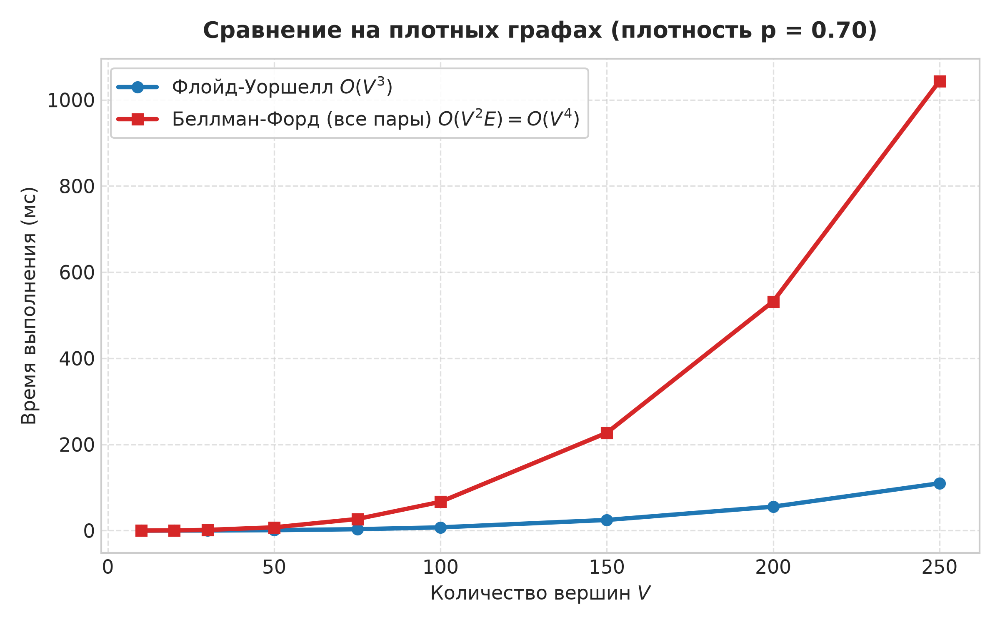
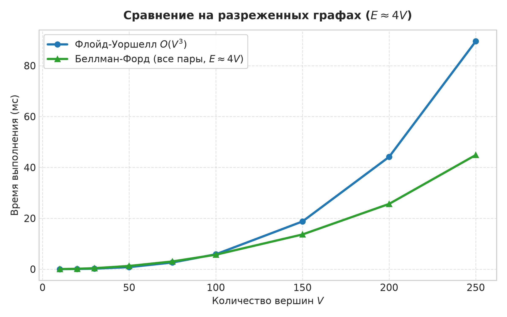
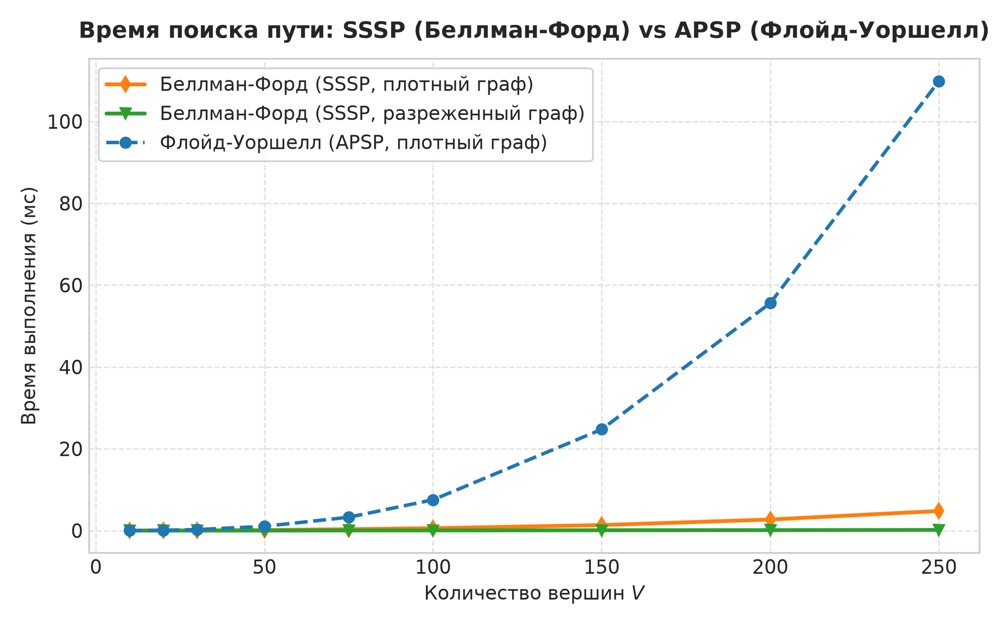
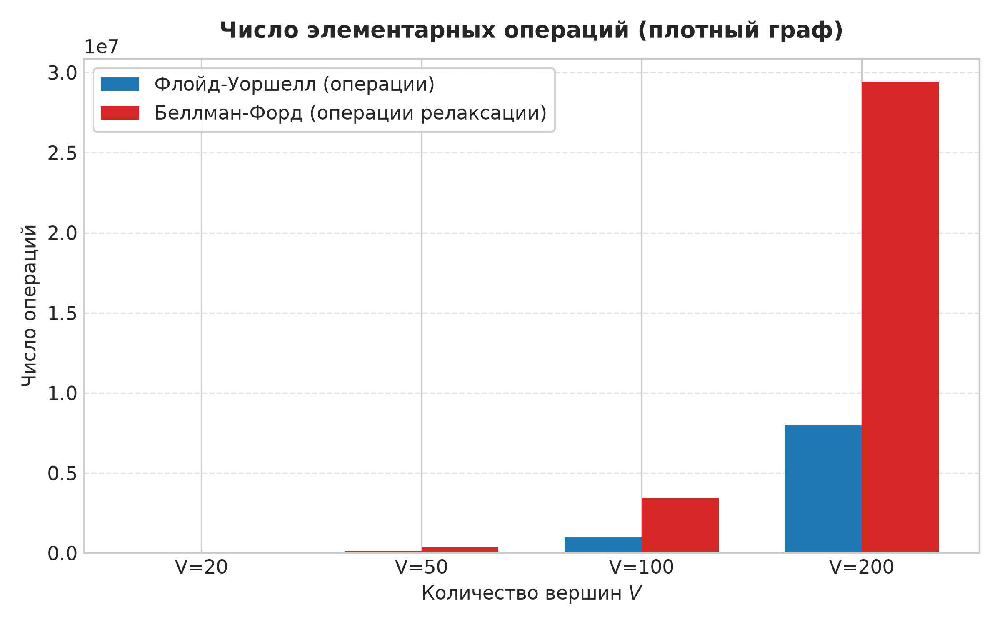

# Сравнительный анализ алгоритмов поиска пути в графе: алгоритм Флойда-Уоршелла и алгоритм Беллмана-Форда

[](https://dotnet.microsoft.com/)
[](https://learn.microsoft.com/dotnet/csharp/)
[](LICENSE)

Курсовая работа по дисциплине **«Алгоритмы и структуры данных»**.

* **Автор:** Шаврычев Иван Александрович, гр. Б25-191-2
* **Вуз:** ФГБОУ ВО «Ижевский государственный технический университет имени М.Т. Калашникова»
* **Факультет:** Информационные технологии, радиоэлектроника и приборостроение
* **Кафедра:** Программное обеспечение
* **Научные руководители:** д.э.н., доцент, зав. кафедрой ПО Леонов М.В., ассистент Шикалова Я.А.
* **Ижевск, 2026**

---

## 📌 Описание проекта

Проект представляет собой комплексное сравнительное исследование двух алгоритмов поиска кратчайших путей на взвешенных ориентированных графах:
1. **Алгоритм Флойда-Уоршелла (Floyd-Warshall)** — матричный алгоритм динамического программирования для нахождения кратчайших расстояний между всеми парами вершин (**APSP**) со сложностью $\Theta(V^3)$.
2. **Алгоритм Беллмана-Форда (Bellman-Ford)** — алгоритм последовательной релаксации для задачи поиска путей от одной вершины (**SSSP**) со сложностью $O(V \cdot E)$, а также его обобщение для всех пар вершин (**APSP**) с $V$-кратным запуском и сложностью $O(V^2 E)$.

Оба алгоритма поддерживают рёбра с отрицательными весами и гарантированно диагностируют наличие отрицательных циклов.

---

## 🛠 Архитектура решения на C# (.NET 10.0)

* `Edge.cs` — легковесная структура ориентированного взвешенного ребра `readonly record struct Edge(int From, int To, double Weight)` (без аллокаций в куче).
* `FloydWarshall.cs` — реализация алгоритма Флойда-Уоршелла с матрицей переходов `Next` для восстановления путей, проверкой циклов отрицательного веса и пропуском холостых итераций (`double.IsPositiveInfinity`).
* `BellmanFord.cs` — реализация алгоритма Беллмана-Форда с поддержкой ранней остановки (early termination flag `updated`), поиском циклов отрицательного веса и решением APSP.
* `GraphGenerator.cs` — генератор случайных графов модели Эрдёша-Реньи $G(n, p)$ для плотных ($p = 0.70$) и разреженных ($E \approx 4V$) графов.
* `BenchmarkRunner.cs` — модуль экспериментальных замеров с использованием прецизионного таймера `System.Diagnostics.Stopwatch` (QueryPerformanceCounter, разрешение < 100 нс), прогревом JIT и изоляцией памяти.
* `Program.cs` — автоматическая верификация корректности (набор юнит-тестов) и запуск бенчмарка.

---

## 📊 Результаты экспериментального исследования

Испытания проводились на аппаратном стенде:
* **Процессор (CPU):** Intel(R) Core(TM) i5-10400F @ 2.90 GHz (6 ядер, 12 потоков)
* **Оперативная память:** 16 ГБ DDR4 (2666 МГц)
* **ОС:** Microsoft Windows 11 Pro 64-bit

### 1. Плотные графы ($p = 0.70$, $E \approx 0.70 V^2$)
| Вершин ($V$) | Рёбер ($E$) | Флойд-Уоршелл (APSP), мс | Беллман-Форд (1 исток), мс | Беллман-Форд (все пары), мс |
| :---: | :---: | :---: | :---: | :---: |
| 10 | 65 | 0.015 | 0.006 | 0.054 |
| 20 | 271 | 0.100 | 0.028 | 0.552 |
| 50 | 1726 | 1.052 | 0.140 | 7.647 |
| 100 | 6961 | 7.536 | 0.594 | 66.824 |
| 150 | 15669 | 24.755 | 1.357 | 227.041 |
| 200 | 27968 | 55.616 | 2.718 | 531.950 |
| **250** | **43640** | **109.870** | **4.806** | **1043.623** |

> **Вывод:** На плотных графах Флойд-Уоршелл быстрее Беллмана-Форда в **9.5 раз** при $V=250$, что строго согласуется с теоретической оценкой $\Theta(V^3)$ против $O(V^4)$.

### 2. Разреженные графы ($E \approx 4V$)
| Вершин ($V$) | Рёбер ($E$) | Флойд-Уоршелл (APSP), мс | Беллман-Форд (1 исток), мс | Беллман-Форд (все пары), мс |
| :---: | :---: | :---: | :---: | :---: |
| 10 | 46 | 0.014 | 0.005 | 0.039 |
| 20 | 95 | 0.071 | 0.009 | 0.165 |
| 50 | 241 | 0.803 | 0.025 | 1.262 |
| 100 | 492 | 5.855 | 0.056 | 5.686 |
| 150 | 738 | 18.753 | 0.091 | 13.639 |
| 200 | 991 | 44.137 | 0.121 | 25.652 |
| **250** | **1278** | **89.581** | **0.171** | **44.879** |

> **Вывод:** На разреженных графах алгоритм Беллмана-Форда за счет малого числа рёбер и оптимизации ранней остановки решает задачу APSP в **2 раза быстрее** Флойда-Уоршелла. Для задачи одного истока (SSSP) Беллман-Форд работает быстрее более чем в **500 раз** (0.171 мс).

---

## 📈 Графики

<p align="center">
  
  
</p>
<p align="center">
  
  
</p>

---

## 🚀 Запуск проекта

Требуется установленный [.NET 10.0 SDK](https://dotnet.microsoft.com/download).

```bash
# Клонирование репозитория
git clone https://github.com/ivan443250/graph-algorithms-benchmark.git
cd graph-algorithms-benchmark/GraphAlgorithms

# Сборка и запуск верификационных тестов и бенчмарков
dotnet run -c Release
```
